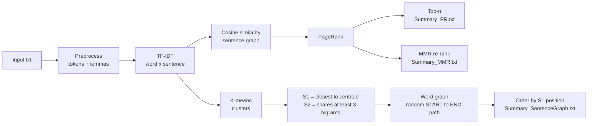
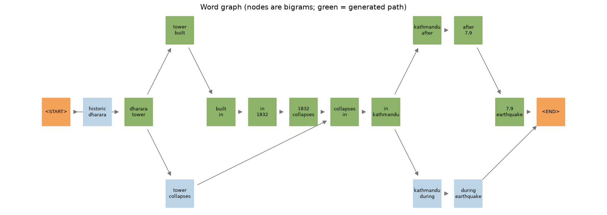
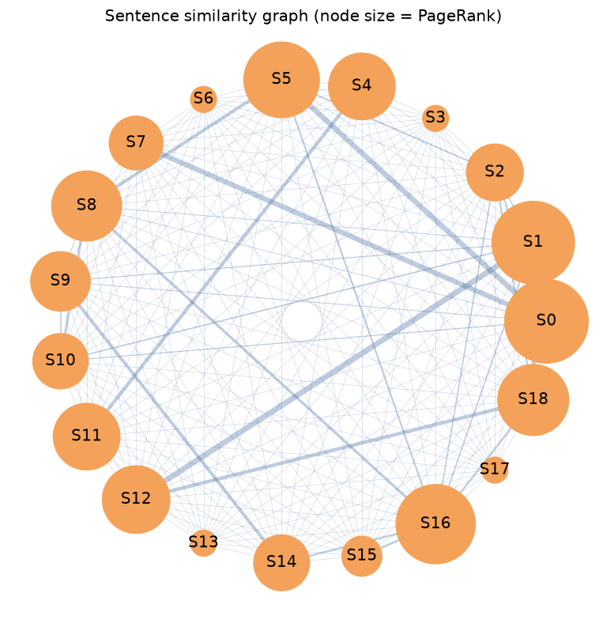

# Graph-Based Text Summarization

Extractive and lightly abstractive summarization built from classic NLP and graph algorithms. No pretrained models are used.

| Stage | Technique | Code |
|---|---|---|
| Preprocessing | Punctuation removal, lowercasing, tokenization, stopword removal, POS-aware lemmatization (NLTK) | [`preprocessing.py`](summarizer/preprocessing.py) |
| Representation | TF-IDF vectors, implemented from scratch | [`tfidf.py`](summarizer/tfidf.py) |
| Ranking | PageRank on a complete sentence-similarity graph (NetworkX) | [`pagerank.py`](summarizer/pagerank.py) |
| Redundancy removal | Maximal Marginal Relevance (MMR) re-ranking | [`mmr.py`](summarizer/mmr.py) |
| Topic grouping | K-means with cosine similarity, from scratch; scikit-learn baseline | [`clustering.py`](summarizer/clustering.py) |
| Sentence generation | Bigram word graph that fuses two related sentences into a new one | [`sentence_graph.py`](summarizer/sentence_graph.py) |



## Quick start

```bash
python -m venv .venv
source .venv/bin/activate          # Windows: .venv\Scripts\activate
pip install -r requirements.txt

python summarize.py data/river_flood_news.txt -n 4 --lambda 0.5 --seed 0
pytest -q
```

NLTK data (tokenizer, stopwords, WordNet, POS tagger) is downloaded automatically on first run.

### Options

| Flag | Default | Meaning |
|---|---|---|
| `--method` | `all` | `pagerank`, `mmr`, `cluster` or `all` |
| `-n` | `3` | Summary length; also the number of clusters K |
| `--lambda` | `0.7` | MMR trade-off: 1 = importance only, 0 = diversity only |
| `--split` | `line` | `line` = one sentence per line (as in the assignment); `sentence` = NLTK Punkt sentence splitter |
| `--kmeans` | `scratch` | `scratch` (from-scratch implementation) or `sklearn` (baseline) |
| `--seed` | `42` | Seeds every random choice, so runs are reproducible |
| `--out` | `outputs/` | Folder for `Summary_PR.txt`, `Summary_MMR.txt` and `Summary_SentenceGraph.txt` |
| `--plot` | off | Also save `similarity_graph.png` |

## Example: why MMR matters

[`data/river_flood_news.txt`](data/river_flood_news.txt) is a short news-style text that deliberately states the same facts twice. PageRank rewards sentences similar to many others, so it picks both versions of the opening fact (cosine similarity 0.69):

```
PageRank                                              MMR (lambda = 0.5)
-------------------------------------------------     -------------------------------------------------
Heavy rain caused the Mill River to flood ...         Heavy rain caused the Mill River to flood ...
The Mill River flooded Eastbrook ... heavy rain.  <-  (dropped as redundant)
Emergency crews evacuated about three hundred ...     Emergency crews evacuated about three hundred ...
No injuries were reported, but several roads ...      No injuries were reported, but several roads ...
                                                      Officials said the damage ... weeks to repair.
```

The cluster pipeline groups the two evacuation sentences together and fuses them through the word graph into a sentence that isn't in the input:

> Around three hundred residents **from homes** along the river **were evacuated by** emergency crews.

All sample outputs are in [`outputs/`](outputs/).

## How the word graph creates new sentences

Each node is a bigram, and bigrams that both sentences share collapse into one node. A random walk from START to END can therefore switch from one sentence to the other at a shared node. The green path below is the assignment's own example:



*"dharara tower built in 1832 collapses in kathmandu after 7.9 earthquake"*

## Sentence-similarity graph

Each node is a sentence, sized by its PageRank score. Edge width shows TF-IDF cosine similarity.



## Project layout

```
summarize.py              CLI entry point
summarizer/
  preprocessing.py        sentence splitting and normalisation
  tfidf.py                TF-IDF matrix and cosine similarity
  pagerank.py             similarity graph and PageRank
  mmr.py                  Maximal Marginal Relevance
  clustering.py           K-means (from scratch and scikit-learn)
  sentence_graph.py       bigram word graph and sentence fusion
  pipeline.py             end-to-end summarizers
  visualize.py            figures
tests/                    pytest suite (unit tests for each stage plus pipeline tests)
data/                     sample inputs
outputs/                  sample summaries
docs/                     problem statement, design notes, figures
scripts/make_figures.py   regenerates docs/images
```

## Further reading

- [Problem statement](docs/problem_statement.md): what was asked.
- [How it works](docs/how_it_works.md): the algorithms, formulas, complexity, and where and why the implementation departs from the spec.

## Limitations

- TF-IDF is lexical, so it misses paraphrases that use different words. Sentence embeddings would capture them.
- Fused sentences are built from lowercase, punctuation-free tokens, so they lose capitalisation of names (e.g. "eastbrook").
- With few sentences, IDF becomes coarse: a word that appears in every sentence gets weight 0.
- No ROUGE evaluation against reference summaries is included.
